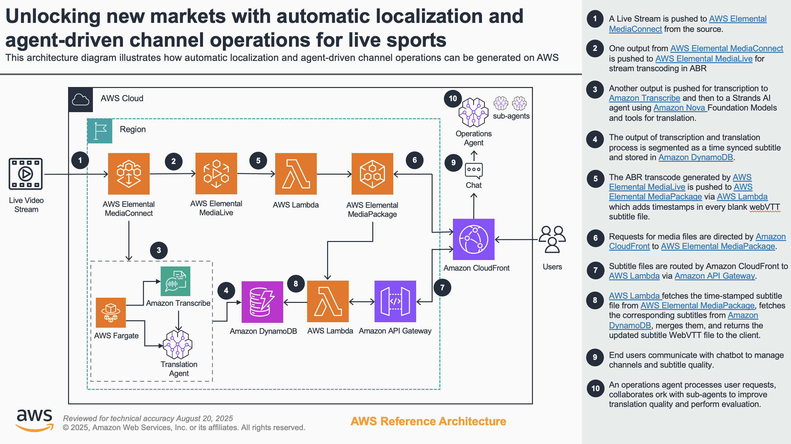

# Auto Live Multilingual Subtitling

Real-time multilingual subtitle generation for live video streams using AWS services. The system processes live video, performs speech-to-text transcription with Amazon Transcribe, translates via Amazon Bedrock, and delivers synchronized subtitles across 20 languages.

## Architecture Overview

Built with AWS CDK and **7 interconnected stacks**:



**Key Features:**
- ECS Fargate-based audio processing (4 vCPU, 8 GB RAM)
- Real-time transcription and AI-powered translation
- Dynamic language management via REST API
- AI chatbot assistant (Strands Agent)
- 4-screen simultaneous playback with per-screen language selection
- 20 pre-configured languages (4 active by default: en, de, es, it)

---

## Stack Overview

### 1. VideoPlayerStack
S3 + CloudFront hosting for web frontend with 2x2 video grid, per-screen language selection, and draggable AI chatbot panel.

### 2. CognitoStack
User authentication via OAuth2 with email-based sign-in.

### 3. UDPAudioReceiverStack
VPC, DynamoDB tables (SubtitleTable + LanguageConfigTable), API Gateway, and Lambda functions for language management and AI chatbot.

### 4. EcsSubtitleProcessorStack ⭐ **Primary Compute**
- ECS Fargate cluster with Docker container (Node.js + FFmpeg)
- Network Load Balancer with Elastic IP for MediaConnect RTP input
- Real-time transcription → Bedrock translation → DynamoDB storage

### 5. BaseLiveStreamingStack
MediaPackage (HLS), CloudFront distributions (video + subtitles), Lambda@Edge for WebVTT delivery.

### 6. MediaLiveStack
- MediaConnect Flow (SRT listener on port 3088)
- MediaConnect outputs: Audio → ECS NLB, Video → MediaLive
- MediaLive channel with 20 pre-configured caption slots

### 7. DeployStack
Frontend asset deployment and configuration management.

---

## Prerequisites

```bash
# Required: Node.js 18+, AWS CLI, Docker
npm install -g aws-cdk

# Bootstrap CDK (MUST use us-east-1 for Lambda@Edge)
cdk bootstrap aws://ACCOUNT-ID/us-east-1
```

⚠️ All stacks must deploy to **us-east-1** (Lambda@Edge requirement).

---

## Deployment

```bash
npm install
npm run deploy-all
```

**Deployment time**: ~15-20 minutes

**Stack order** (managed by CDK):
1. VideoPlayer → Cognito → UDPAudioReceiver
2. BaseLiveStreaming + EcsSubtitleProcessor (parallel)
3. MediaLive → Deploy

---

## How to Start

### 1. Access Video Player
Navigate to CloudFront URL from CloudFormation outputs → Register/Login via Cognito

### 2. Start AWS Services
```bash
# Start MediaConnect Flow
aws mediaconnect start-flow --flow-arn <FLOW_ARN>


### 3. Stream Live Video

**Option 1: OBS Studio**
- Server: `srt://MEDIACONNECT_IP:3088`

**Option 2: FFmpeg**
```bash
ffmpeg -re -stream_loop -1 -i ~/sample.mp4 \
  -vcodec libx264 -b:v 2000k -r 25 -vf scale=1920:1080 \
  -acodec aac -ac 2 -ab 128k -ar 48000 \
  -f mpegts "srt://MEDIACONNECT_IP:3088?mode=caller"
```

### 4. View Stream
Wait 5-10 seconds → Click **"Start Live Events"** → Subtitles appear automatically

---

## Language Management

**Default Active**: en, de, es, it (4 of 20 languages)


## Monitoring

**ECS Logs:**
```bash
aws logs tail /ecs/subtitle-processor --follow
```
---

## Clean Up

```bash
# Stop services first
aws mediaconnect stop-flow --flow-arn <FLOW_ARN>
aws medialive stop-channel --channel-id <CHANNEL_ID>

# Destroy stacks
cdk destroy --all
```

⚠️ Lambda@Edge may require manual deletion (wait 1-2 hours for CloudFront release).

---

## Migration Notes

**Legacy EC2** (disabled): `/lib/legacy_subtitle_processor_ec2.js`


---

## License

MIT-0 License. See [LICENSE](LICENSE).

## Contributors

Owner: TaeHoon Kyeong, Sanjay Singh
Contributor: Bernhard Widtman, Yongzhe Ren
